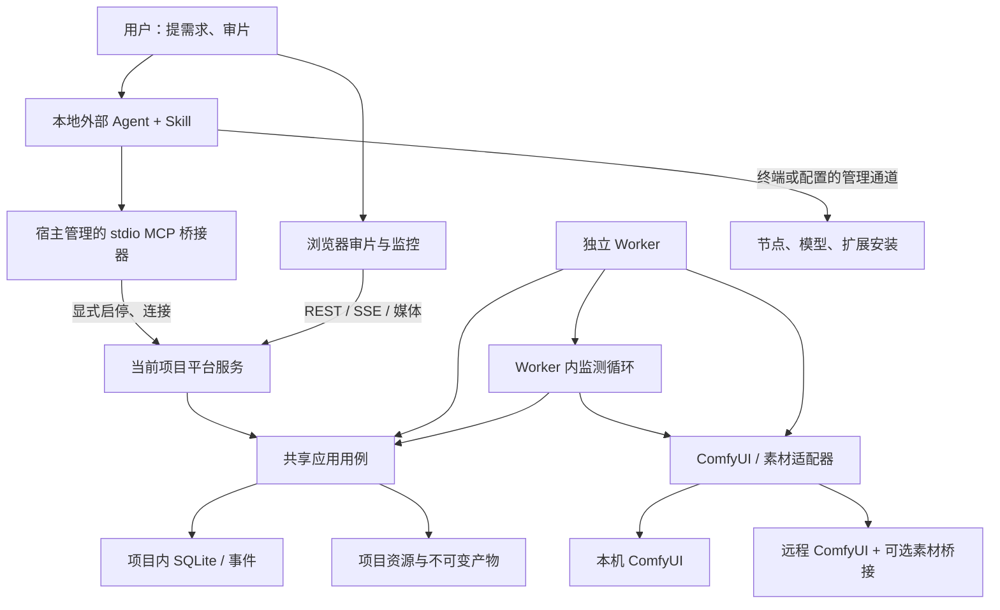
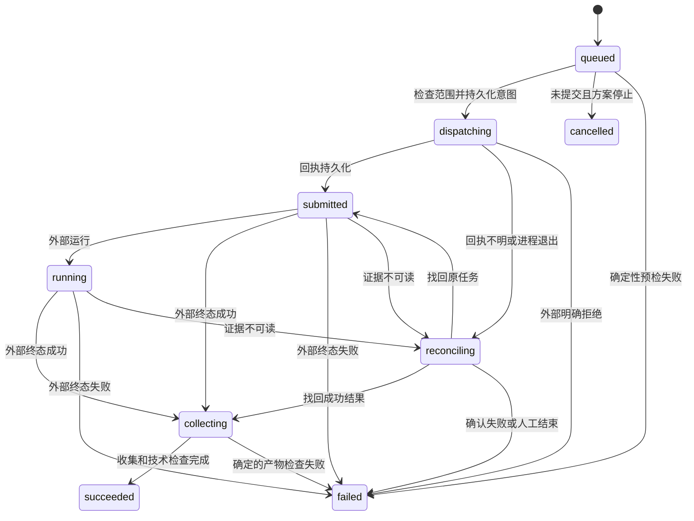

# ComfyPilot 架构设计

日期：2026-10-27（Asia/Shanghai）

状态：设计约定，未实现。需求见[产品需求](product-requirements.md)，发布边界见[首版范围与验收](mvp-scope.md)，选型依据见[技术调研与分期](research-and-roadmap.md)。

## 1. 架构结论

采用“项目级模块化单体 + 独立持久 Worker + 待机 MCP 桥接器 + Skill”的形态。服务在 Agent 指定的当前项目目录启动，配置和主状态均在该目录。前端以审片为主，Agent 通过结构化接口操作同一套状态。

一个项目一个实例，一个实例管理多个本机/远程 ComfyUI 执行端。首版项目总生成并发为 1，任务固定目标后串行派发。默认无账号、无平台密钥，监听回环地址；局域网审片由项目配置显式启用。

不建立用户级常驻服务、全局项目注册表或全局当前项目。程序、MCP 和 Skill 可以安装在宿主要求的位置，但不能借此把平台配置写到用户目录。远端只保存执行依赖、受管素材及必要归属清单，平台主元数据始终留在当前项目。

## 2. 组件与进程



| 组件 | 生命周期与责任 |
| --- | --- |
| MCP 桥接器 | 由 Claude Code、Codex 等宿主管理；默认待机，只响应明确调用 |
| Skill | 指导 Agent 选择项目、初始化、启停、检查依赖、执行和读取反馈；本身不是守护进程 |
| 项目启动器 | 幂等启动本项目 API 与 Worker，记录进程身份，提供状态与停止 |
| API 服务 | REST、SSE、媒体传输、上下文、事务和业务规则 |
| 独立 Worker | 数据库领取、提交、监测、对账、自动收片和技术检查；不依赖请求或 Agent 会话存活 |
| 监测循环 | Worker 内的常驻程序，采集心跳、执行端信息与进度，更新统一状态；不调用大模型 |
| ComfyUI | 现有生成环境，可位于本机或远端；不随平台退出而被停止 |
| 素材桥接扩展 | 在目标 ComfyUI 上管理本项目专属素材目录；不运行任意管理命令 |

MCP stdio 客户端启动服务端子进程属于[协议规定的生命周期](https://modelcontextprotocol.io/specification/2026-07-28/basic/transports/stdio)。本项目控制的是桥接器是否连接平台，不能假设能够控制宿主何时启动 MCP。

### 2.1 启动、连接与停止契约

1. MCP 初始化和 tools/list 仅提供静态工具说明，不写项目文件、不读取全局配置、不向平台或 ComfyUI 发网络请求。
2. Skill 要求 Agent 传入绝对 project_root。显式 inspect_project 可以检查该目录，但不能顺便启动服务。
3. init_project 显式创建项目；start_service 在该项目工作目录启动 API/Worker，返回服务地址与实例标识；connect_service 校验项目与实例标识后建立桥接连接。
4. 非连接状态下的业务工具返回 service_not_connected 和可操作提示，不隐式启动或重连其他项目。
5. disconnect_service 只断开桥接；宿主退出也不终止 API/Worker。启动器必须使用独立进程组，并分别在首发系统验证脱离父进程的行为。
6. stop_service 先禁止新派发，保存调度暂停状态，完成当前短事务后停止本项目进程。不等待远端生成结束，不向 ComfyUI 发中断；再次启动优先恢复对账和收片，派发恢复需要 Agent 明确执行 resume_dispatch。
7. Worker 单独异常时可在项目服务仍运行期间由启动器恢复；收到显式停止后不得自行拉起整个平台。

同项目启动用项目内进程锁去重。runtime.json 保存项目 UUID、规范根路径、instance_id、API/Worker 的 PID、端口和启动时间；校验进程身份与响应一致后才能复用或停止。端口被其他程序占用时返回冲突，不能杀进程。

M1/1.2 的本机实现：`start/status/stop/resume-dispatch` 共用项目生命周期用例，`serve` 保留前台调试方式。控制锁串行化启动和停止，API/Worker 各持有自己的进程锁；后台启动预先绑定回环 socket，将描述符交给独立会话，日志和运行记录均保存在项目内。API 通过 lifespan 监督独立 Worker，连续失败最多恢复 3 次，稳定运行 5 秒后重置计数；停止时先取消监督。身份校验同时读取 PID 创建时间、程序路径、工作目录与本机健康回执，不跟随健康端点的 HTTP 重定向，不使用代理。

格式 2 的 SQLite 增加 `service_control` 持久保存手动派发开关，`worker_status.instance_id` 隔离历次实例心跳。启动和停止保持派发暂停；当前解除开关不会执行生成，任务领取与对账/收片门禁由相应开发任务接入。API 已消失但 Worker 仍存活时，本阶段返回诊断并保留现场，不进行缺少健康回执的接管。进程机制面向 POSIX，macOS 已实测，Linux 的实测仍由 M1/1.7 覆盖。

服务端仅接受自身项目 UUID。桥接器每次调用携带 project_root 与 connection_ref，不维护一个隐式全局“当前项目”。两个项目可独立运行；同项目多个桥接器共用一个实例。断开或替换实例后旧连接返回连接失效。

M1/1.3 的实现位于 `server/comfypilot/mcp_bridge.py`，随同一个 wheel 发布 `comfypilot-mcp` 入口，使用官方 Python MCP SDK 2.3.0。初始化和工具枚举只构建静态 schema，不读取项目或访问网络。生命周期调用复用现有项目/服务用例；项目检查和连接仅读取文件，不借加载操作迁移数据库。启动服务不会自动连接。

连接表仅位于各 MCP 进程内，引用固定规范根目录、项目 UUID、实例 ID、API 的 PID/启动时间/程序路径和端口；Worker 在同一 API 下恢复不使引用失效。读取状态先校验运行记录及健康回执，再读取网页共用的 `/api/project` 并核对其项目和实例。无引用或引用已断开返回 `service_not_connected`，跨项目返回 `project_mismatch`，实例或 API 身份变化返回 `connection_invalidated`。

`stop_service` 是显式生命周期操作，无引用时停止给定目录的当前实例；携带引用时，在共享的项目控制锁内核对绑定实例后才暂停和停止，避免旧引用控制新实例。常驻启动者用后台等待线程回收自己启动且已退出的 API 子进程，避免其他桥接器把僵尸进程误判为停止超时；该线程不改变服务会话归属，不在 MCP 退出时终止平台。

M1/1.4 将 SQLite 升级至格式 3，以 `config_revisions` 保存不可变配置与 YAML 源文件哈希。初始化或旧项目首次迁移建立首个有效修订；之后读取数据库中的有效配置，文件修改只形成草稿。显式更新/刷新在项目配置锁和短事务内校验 `expected_revision`，非法内容与冲突不替换有效修订。服务端口在重启时绑定，目标变更只影响后续解析，历史目标快照保留原地址和修订。

网页设置与 MCP 通过同一应用 API 修改配置。写操作核对实例请求头和本机同源边界，校验错误不回显输入。凭据只从 `.comfypilot/secrets.local.yaml` 读取，公开配置只存 `credential_ref`；重复地址返回合并提示，不自动合并身份。目标解析不进行网络探测，无明确目标返回 `needs_input`，能力探测由 M1/1.5 接入。

## 3. 项目目录与配置

以下为使用者项目的目标结构，不代表当前仓库已经生成这些文件：

```text
<project_root>/
  comfypilot.yaml                    可编辑项目配置
  workflows/<recipe-id>/             画布原件、API 图、绑定与使用说明
  custom_nodes/<package-id>/         用户节点源码或固定版本来源、安装说明
  modules/<module-id>/               模块声明、配方目录与 Agent 操作说明
  skills/                           可选的项目专用 Skill
  .comfypilot/
    project.json                    稳定项目 UUID、数据格式版本
    state.sqlite                    任务、运行、反馈、事件、素材引用
    resource-lock.json              已解析资源版本及内容哈希
    secrets.local.yaml              可选的远程服务凭据，排除版本控制/导出
    runtime.json                    运行实例描述，排除版本控制/导出
    locks/                          本机进程锁
    artifacts/                      输入、原始产物、截图与播放代理
    runs/<run-id>/                  意图、回执、最终图与检查证据
    staging/                        正在上传/收集的临时文件
    logs/                           脱敏运行日志
```

comfypilot.yaml 保存监听方式、端口、执行端列表、默认目标、用户指定路由、启用模块、资源路径、导入上限、监测间隔/过期阈值、收片重试和清理策略。数据库保存配置修订及运行快照；配置文件是期望配置，数据库中的已验证修订是执行依据。

初次使用由 Agent 询问缺失项。修改文件后通过显式 refresh_project 校验并发布新配置/资源修订；首版不做隐式热更新。影响连接的修改使后续方案重新预检，在途运行保留原地址与能力快照。

选中的内置模块资源复制或导出到当前项目，标记来源和包版本。用户可以查看、修改或新增；执行冻结内容，不引用会随软件更新改变的安装包模板。

初始生成项目忽略规则，排除运行状态、秘密和大体积产物；是否跟踪工作流、模块与节点源码由用户的版本控制策略决定。只使用本机磁盘保存 SQLite。目录移动后校验 UUID 并更新规范根路径；“恢复为新副本”生成新 UUID，不接管旧项目的远端素材。

## 4. 技术选择与代码边界

| 部分 | 选择 | 原因与边界 |
| --- | --- | --- |
| Web | React、TypeScript | 以媒体审阅与表单为首版主界面 |
| 服务与启动器 | Python、FastAPI、项目级 CLI | 复用媒体处理工具；CLI 与 MCP 调用同一用例 |
| MCP | stdio 桥接器与官方 SDK | 不依赖平台 HTTP MCP 常驻入口；精确 SDK/协议版本发布时实测 |
| 元数据 | 本机 SQLite、WAL、短事务 | 状态与事件同事务；不用网络盘共享数据库 |
| 队列 | 数据库 Run 记录、一个 Worker | 无 Redis、消息集群或分布式锁 |
| 文件 | 项目内文件、哈希与版本引用 | 传输采用流式操作，不用数据库存视频字节 |
| 媒体 | FFmpeg、ffprobe、图片解码库 | 检查与播放代理明确分开，版本在实现时锁定 |
| 页面更新 | SSE + 持久事件游标 + 最新监测快照 | 业务事件重连补读；指标覆盖更新；大媒体使用独立 Range 接口 |
| 后续业务画布 | React Flow 候选 | 第二期才引入编辑能力；它不负责执行或工作流转换 |

SQLite WAL 的本机共享内存约束见[官方文档](https://www.sqlite.org/wal.html)。重型执行不依赖 Web 请求结束后的后台回调，独立进程负责接续。

预期代码组织：

```text
apps/web/                         审片、资源和设置界面
server/domain/                    项目、任务、运行、版本和反馈规则
server/application/               命令、查询、事务和调度
server/interfaces/                HTTP、SSE、CLI 与本地控制
server/worker/                    监测、执行、对账、自动收片和检查
server/modules/                   内置模块注册与模块专属规则
server/adapters/                   ComfyUI、素材传输、本机存储
packages/mcp_bridge/              待机桥接器，不内置生成逻辑
packages/skills/                  平台和模块操作说明
presets/                          已验证模块、配方与依赖说明
integrations/comfyui_assets/       受限素材桥接扩展
tests/                            领域、接口、故障与真实环境验收
```

接口调用 application，application 使用 domain 和适配器接口。核心不要求人物 ID、镜头编号、GPU UUID 或某模型名称。首版保留通用产物类型，但不建设独立文本应用。

## 5. 模块、配方与节点资源

### 5.1 三层契约

| 层 | 应包含的内容 | 不承担的职责 |
| --- | --- | --- |
| Module | ID、版本、用途、任务输入输出 schema、配方清单、检查/预览类型、操作说明 | 不携带通用调度器副本 |
| Recipe | 画布原件、API 图、参数绑定、输入顺序、输出适配、依赖、兼容清单、例子 | 不假设目标已安装所需环境 |
| Skill | 发现资源、选目标、补依赖、执行、审片反馈与异常处理步骤 | 不作为账号或安全权限系统 |

首版以静态注册的视频人物替换模块提供专属能力；项目扩展主要增加声明式配方与资源。自定义 Python 检查器、Web 插件或可执行服务插件需要后续设计，不能把项目目录中的代码自动 import 进平台。

人物替换模块处理片段范围、参考人物素材、替换参数、原片时间映射与视觉反馈；底层只产生标准任务、Run、Version、Feedback 和 Decision。

### 5.2 依赖与安装

节点资源至少记录仓库/来源、固定 commit 或版本、许可、Python/系统依赖、模型引用、安装步骤、重启要求、验证方式和回退说明。未知版本标记未知，不伪造精确环境或一致性保证。

资源状态分开记录：已发现、声明完整、目标缺依赖、目标预检通过、实测通过。安装证明与 object_info、模型清单、测试回执按 target_id 保存，不在所有目标间共享“已安装”标记。

Agent 通过本机终端或用户配置的远端管理通道安装到实际 ComfyUI 环境，安装前说明变更及运行影响。可复用官方 Comfy CLI 的节点管理和快照能力，调用必须显式指向目标环境，不能依赖其全局默认目标或云端自动路由。需要写工具配置时使用项目内路径；不能做到项目隔离的便捷命令不自动调用。

素材桥接安装后同样要验证。涉及 ComfyUI 重启时先检查目标已有任务，在用户允许的窗口执行，不能为补依赖中断其他任务。无远端管理能力时输出具体缺项，已可执行配方仍可使用；不将普通 HTTP 连接等同于主机管理授权。

### 5.3 原件、执行图与版本

ComfyUI 画布 JSON、API 图和后续业务图是不同格式。原件必须保留；Recipe 执行要求取得经工具验证的 API 图、完整绑定和输出规则。带子图或前端 widget 的转换依赖对应 ComfyUI/工具版本，不能用数组位置推测。

资源目录刷新生成内容哈希与清单；同标识冲突必须显式覆盖。Run 保存解析后的实际图、配方哈希、输入与依赖快照，不直接读取可变磁盘文件作为历史证据。

## 6. 核心状态与约束

| 对象 | 关键内容 |
| --- | --- |
| Project | UUID、根路径、目标、配置修订、调度状态 |
| ExecutionTarget | ID、修订、API 地址、素材适配、可选管理说明、秘密引用、能力与预检证据 |
| Module / RecipeSnapshot | 模块与配方身份、版本、资源哈希、schema 和依赖证据 |
| Task | 目标、验收标准、状态、采用版本引用、revision |
| PlanRevision | 确定步骤、输入版本、参数、配方、执行端修订、次数与反馈关联 |
| ExecutionMandate | 用户指示摘要、来源、适用修订、允许范围、次数、暂停条件、状态 |
| Run | 动作索引、目标快照、状态、提交意图、外部 ID、收片阶段/检查点、错误与时间 |
| StatusSnapshot | 项目/实例/目标标识、业务修订与事件游标、带来源和采集时间的监测值；作为查询视图，不建立指标历史库 |
| ArtifactVersion | 内容哈希、存储位置、类型、来源 Run、输入版本、媒体信息 |
| Check | 技术检查项、状态、实际值、预期值和证据 |
| Feedback / Decision | 指定版本、时间/圈选、意见状态、用户结论及来源 |
| AssetReplica / AssetReference | 所属项目/目标、远端路径或资产 ID、指纹、引用与删除状态 |
| CleanupPlan | 范围、候选、保护理由、预计空间、状态和逐项结果 |
| Event | 单调序号、对象/修订、来源、动作、摘要与时间 |

无 Principal、账号、能力令牌等首版必需实体。来源标签如 web_user、agent、worker 用于记录，不用来声称身份可靠。

不可变版本允许相同字节共享存储，来源和反馈仍独立。数据库至少保证同 PlanRevision/action_index 一个 Run、同 Run/output_slot 一个产物登记、可变对象的 expected_revision 比较更新，以及状态/额度/事件同事务。

任务进展、执行状态、技术检查、用户评价和采用关系独立。“通过并采用”一次操作可同时保存两个事实；失败候选不会清除采用引用。Agent 代录用户决定保存用户原意和来源，Agent 自己的观察不能默认提升为用户通过。

## 7. 多执行端调度与可靠提交

首版项目总生成并发 1。每步解析并冻结 target_id 与配置修订；默认目标来自用户设置，任务显式目标优先。路由规则不完整时返回询问项，不擅自换端、转云或调整次数。

地址修改不改变已有 Run；若原端无法再访问，该 Run 待核对，不使用新地址上的同名 prompt_id 冒充原任务。同一物理 ComfyUI 的重复配置在初始化时提示合并；不按端口数量假设有更多 GPU。

派发过程：

1. 创建方案修订与用户执行指示，明确输入、参数、配方、目标与最大提交次数。
2. execute_plan 使用 command_id 和动作唯一约束幂等入队，立即返回 Run ID。
3. Worker 优先对账/收片。领取前检查项目、方案、反馈挂起、目标能力、外部队列、输入哈希与额度。
4. 在短事务中再次检查可派发条件，预留额度、保存 intent、client_id、最终图哈希、目标快照和事件，进入 dispatching。
5. 事务提交后发送一次 POST /prompt；回执立即落盘。明确拒绝记失败，响应不明进入 reconciling。
6. 只跟踪原外部 ID；终态成功后收集、检查和登记产物，再派发下一次生成。

本地幂等不等于外部“恰好执行一次”：数据库与 ComfyUI 请求无法原子提交。提交不明占一次额度，默认阻塞项目的新生成派发，继续读取反馈与收片。未知外部任务不被接管、清空或中断，默认等待并向 Agent 说明。

新的方案修订不会直接改变旧修订。用户指示替换生效时，同事务挂起旧的未提交步骤；仅写草稿不暂停旧方案。范围内连续操作不需要逐步骤批准，超范围由 Agent 取得新指示。

生成必须经平台 execute_plan 路径，Agent 不通过另一条 CLI 或直接 POST 绕过记录。用户在外部手动生成的结果只能显式导入并标明外部来源，不冒充平台已追踪的 Run。

## 8. 运行状态与恢复



| 已保存状态 | 重启后的行为 |
| --- | --- |
| queued、无 intent | 保留队列；对账完成且明确恢复派发后再检查指示 |
| 有 intent、无回执 | 用原 client_id、图和时间等证据查询 queue/history，不能唯一匹配就待核对 |
| 有外部 ID | 查询原目标和原 ID，绝不重新提交 |
| 已保存成功 history | 接续收片，不要求外部 history 永久存在 |
| collecting 中断 | 接续传输/检查；暂时不可读保持 collecting，不改为待重试生成 |
| 产物已登记 | 按 Run/输出槽位返回既有版本；内容指纹改变则留证阻断 |
| 明确失败或人工结束 | 保存证据；另开尝试必须建立新 Run |

第一次 history 为空且 queue 无记录后，再读一次 history，处理恰好完成的竞态。仍无证据不表示从未执行。人工结束不确定尝试只结束本地等待，不能断言外部任务已停止；原记录永久保留。

启动恢复与恢复派发分开。普通进程重启先对账收片，resume_dispatch 明确开启新生成；备份恢复始终暂停。采样 100%、某节点 executed 均不能替代整个工作流的成功终态。

## 9. 素材传输、收片与清理

### 9.1 适配器与能力探测

ComfyUI 的标准路由包含状态、提交、队列、history、图片上传和文件读取等，不能将 /userdata 的删除接口当作 input/output 通用删除能力，参见[官方路由表](https://docs.comfy.org/development/comfyui-server/comms_routes)。

目标能力分开记录：execute、upload_image、upload_video、download_output、managed_asset_inventory、delete_managed_asset、environment_manage。能力来自实际探测和配置，不能仅根据“远程/本机”推断。

素材适配器契约为探测、写入受管输入、读取声明输出、查询受管清单、准备删除和删除；通用视频不假设 /upload/image 可用。原生 HTTP 覆盖不足时使用首版素材桥接。

桥接扩展使用 input/ComfyPilot/<project_uuid>/ 和 output/ComfyPilot/<project_uuid>/ 等专属子目录。配方必须将上传引用和输出前缀绑定到该空间；忽略前缀、写到其他目录的节点结果不能自动取得清理资格。扩展只接受资产 ID 与受管相对位置，检查真实路径、符号链接和归属，不能遍历或删除任意 ComfyUI 路径。

远端通用视频通过扩展流式上传/下载，保存项目归属与指纹。已实测原生输出读取可以继续使用；未安装扩展时单独显示缺失传输/清理能力。节点安装依赖另一条管理通道，桥接不提供远程 shell。

### 9.2 自动收片与实时可审

外部成功证据触发 Worker 自动执行以下流程，无需网页或 Agent 再发收片命令。暂停新生成派发时流程继续；停止整个平台后暂停，再启动按原 Run 接续。大文件传输和 FFmpeg 子进程不得阻塞监测循环与心跳。

1. 保存外部成功 history 和输出声明，保护该 Run 对应的所有素材引用。
2. 从目标受管位置流式读取到项目 staging，校验字节数和哈希。
3. 图片真实解码；视频 ffprobe 加完整解码，检查声明的宽高、帧率、帧数/时长。
4. 必要时生成独立播放代理，原始文件与代理各有哈希、元数据和来源。
5. 文件就位后，在事务中登记 Version、Check、Replica、引用和 clip_ready 事件。
6. 页面立即出现可审片段，无需等待整批完成。必需检查失败保留证据，不作为合格候选。

本地导入默认复制到受管存储，不依赖会被用户原地修改的外部文件。大文件不读入整个应用内存，传输前检查本地空间。完整解码与代理生成耗时计入“检查/准备预览”，3 秒实时目标仅衡量事件持久化后的界面更新。

Run 的 collection 字段保存阶段、输出槽位、源资产身份、已传字节、可知总量、检查点、重试次数、下次尝试时间和错误证据。阶段变化持久化并写入事件，字节进度可覆盖更新；collection 是原 Run 的子状态，不建立另一套生成队列。

| 收片阶段 | 含义 |
| --- | --- |
| not_started | 尚无外部终态成功证据 |
| awaiting_output | 已保存成功证据，等待声明的输出可读 |
| transferring | 流式传输到本项目暂存区，显示已传字节与可知总量 |
| verifying | 哈希、解码和声明规格检查 |
| preparing_preview | 需要时生成播放代理，否则跳过 |
| registering | 文件已就位，登记版本、检查与来源关系 |
| ready | 必需检查与预览条件满足，发布 clip_ready |
| retry_wait | 临时网络/读取错误等待退避重试，保留恢复阶段 |
| blocked | 空间、工具或读取条件不足，或自动重试耗尽，等待处理 |
| failed | 原始媒体损坏或确定的必需检查失败，保留证据 |

临时网络/读取错误默认最多 3 次额外退避重试，不能反复提交生成。达到上限保持 collecting/blocked；空间不足或媒体工具缺失直接阻塞。确定的媒体检查失败使 Run 进入 failed，不能通过恢复收片绕过。blocked、retry_wait 的素材仍受清理引用保护。

resume_collection 仅对已有外部成功证据、可恢复的 collecting Run 重新校验源资产并接续检查点；传输端不支持字节续传时可重传暂存文件，但不重新生成。已完成返回既有版本；终态失败不能重置为 collecting。重复恢复命令遵守 command_id、Run 修订与输出槽位唯一约束，不消耗生成额度。源文件指纹变化时留证阻断，不能覆盖已登记版本。

### 9.3 引用与物理删除

AssetReplica 区分本地原始文件、播放代理、远端输入、远端输出与临时文件；一个业务版本可以有多个副本。清理 ComfyUI 副本只改变副本状态，不删除历史版本、回执和采用关系。

首版两阶段接口不等于必须问用户两次。用户已明确删除目标和范围时，Agent 可先准备清单再在该范围内执行；范围含糊时先说明候选并取得具体指示。

1. prepare_cleanup 固定 project_id、target_id、资产 ID、指纹、引用修订、候选理由与估算空间，不删除文件。
2. 保护 queued 到 collecting、待核对、未完成上传、待审、尚未关闭的反馈返工和未来计划需要的副本。未知引用或归属保留；默认不扫描全实例。
3. 输出/临时结果要有项目内已验证原件；待审结果即使有本地副本仍默认保护。输入在不再被计划/活动运行使用且本地原件保留后才可清理。
4. execute_cleanup 再检查当前引用、用户范围与文件身份；短暂标记 deleting，阻止新计划引用；新引用、变更或不确定情况跳过。
5. 适配器在受管空间按固定资产身份删除；桥接扩展串行处理该资产的写入/删除，不能按旧路径误删同名新文件。
6. 返回 deleted、already_missing、protected、changed、failed 等逐项状态，保存操作记录。部分失败可按同计划幂等重试，不能扩大清单。
7. 物理 unlink 用于释放占用；移到同盘回收站不计释放。分别报告删除字节估算与可获得的实际磁盘变化，不承诺两者完全相同。

远端不可达只报告失败，不改用未经配置的 SSH 删除。素材空间专用于本项目；检测到外部任务可能引用且无法排除时保留。首版不做全盘垃圾回收、自动 TTL 或模型/节点卸载。

## 10. 审片、监控与 Agent 接续

### 10.1 审片反馈

Feedback 绑定 artifact_version_id，包含整份说明、video_range、截图引用和归一化矩形。视频保存片段内时间及原片映射；变速或偏移未知时只允许普通并排预览，不冒充同步对应。

用户可用“需要修改”“通过并采用”和备注完成主要操作。“需要修改”对当前有效方案写反馈并在同一事务设 review_hold；Worker 领取和保存 intent 前都检查。已写 intent 属于在途，不承诺撤回；其他未关联任务不受影响。

旧版本反馈不自动挂起新修订，Agent 可明确把该反馈作为新修订待解决事项。Agent 的 addressed 与用户 verified 分开，避免“已经生成新候选”被误认成“用户认可”。

### 10.2 监测循环、快照与面板

项目服务启动且执行端启用后，Worker 内监测循环开始工作；MCP 初始化、工具枚举和桥接器待机不触发连接或采集。暂停派发不停止监测/收片；整个平台停止后不采集、不自启动。Agent 离线不影响这些确定性工作。

ComfyUI 的 WebSocket 事件提供执行阶段、当前节点与实际支持的采样步数，queue/history 用于对账，system_stats 提供其可用的环境字段。progress 只在节点实现相应回调时产生，executed 也不代表每个节点结束；具体语义参见[官方消息说明](https://docs.comfy.org/development/comfyui-server/comms_messages)。无进度时展示阶段和已耗时，不补造整体百分比、ETA，也不据此判断任务失败或自动重投。

健康与基础系统指标默认每 5 秒采集；单次请求有界超时、断连后退避，距最后有效采集满 15 秒标记 stale。模型/节点清单在连接或环境变化时刷新，不随每次心跳全量获取。首版不引入独立大模型监控 Agent、时序数据库或额外监控平台。

get_system_status、get_target_status 和业务状态查询共用下表约定：

| 数据组 | 内容与来源 |
| --- | --- |
| 平台 | project_id、instance_id、API 可达性、Worker 心跳、调度状态和阻塞原因 |
| 执行端 | target_id、配置修订、连接状态、版本及可获取的设备/显存信息 |
| 活动运行 | 原 Run/片段、目标、阶段、节点 ID/名称、实际步数、已耗时与错误引用 |
| 队列与反馈 | queued/在途/挂起/待核对摘要、当前方案修订、review_hold 与次数 |
| 收片与存储 | 原 Run 的 collection 阶段、传输量、检查/代理/登记状态、本地空间与受管素材占用 |
| 可选主机信息 | GPU 利用率/温度、CPU/远端磁盘、完整进程日志；仅通过已配置且具备能力的附加采集提供 |

每项监测值带 source、observed_at（本机采集时间）、expires_at、单位及可用性 fresh/stale/unknown/unsupported。无值、无权限或无能力使用明确状态和原因，不把缺失值转为 0、正常或空闲。远端详细指标不能仅凭 HTTP 地址承诺，也不为了补指标自动开启 SSH 或安装采集器；日志仅返回已允许范围的脱敏内容。

业务字段和 event_cursor 来自同一读取事务；监测值按各自 observed_at 表示采集时刻。普通指标保留最新快照并覆盖更新，不逐次写持久事件或推进业务 revision；运行/收片阶段、故障/恢复和控制结果进入持久事件。进程重启后未采集指标显示 unknown，浏览器保留的旧值标记 stale；重新采集后才恢复为 fresh。

播放器侧栏提供可折叠监控区，底部提供队列/活动。监测更新不切换当前审阅版本、不重建播放器或覆盖播放位置，不清空未提交批注。API 不可达时页面显示连接中断和最后已知状态，不能把所有 Run 改判失败。正常连接下持久业务变化 3 秒内更新；基础指标遵守采集与过期周期。

### 10.3 事件传递与 Agent 接续

SSE 发送带持久游标的业务事件和可覆盖的最新指标；指标更新不占用持久事件序号。浏览器重连先读取快照，再按游标补读并去重。媒体和截图通过独立引用获取，避免播放与状态传输互相阻塞。

Agent 可 read_events 或有上限的 wait_for_events，默认关注任务终态、收片阻塞、审片反馈、连接异常和控制结果，不为每次指标波动持续调用大模型。事件持久化不依赖通知送达，工具返回不保证宿主自动继续采样；Agent 离线时 Worker 继续已有确定任务、自动收片与 review_hold，下次连接提供未解决事项。首版不承诺主动唤醒离线会话。

所有可变对象以 expected_revision 更新，冲突保留草稿。后续画布编辑也遵守同一规则。

## 11. MCP 与应用接口

M1/1.1–1.4 已实现六个生命周期工具、`get_project_status` 及六个配置/目标工具，参数和错误见 [README](../README.md#stdio-mcp)。下表列出首版完整的拟定语义，未在 README 列出的工具尚未实现。业务接口始终限定当前项目，CLI、MCP 和 Web 调用共享 application 用例。

| 操作组 | 拟定工具 | 约束 |
| --- | --- | --- |
| 生命周期 | inspect_project、init_project、start_service、connect_service、disconnect_service、stop_service | 显式调用；本机控制，未连接时可用 |
| 项目配置 | get_project、update_project、refresh_project | 修订检查；秘密不回显 |
| 执行端 | list_targets、probe_target、update_target | 用户指定目标，不接收任意单次 URL 替代配置 |
| 模块资源 | list_modules、inspect_recipe、refresh_resources、check_dependencies | 返回路径、依赖缺项、安装说明和可用目标 |
| 任务与素材 | create_task、import_asset、get_artifact、list_versions | 本机路径经受管导入；文件使用资源引用 |
| 监控查询 | get_system_status、get_target_status、list_runs、get_run | 脱敏统一快照、原对象修订、时间/来源和未知状态 |
| 方案执行与调度 | propose_plan、record_mandate、execute_plan、pause_plan、resume_plan、cancel_queued_runs、resume_dispatch | 指示范围、额度、修订和恢复规则 |
| 自动收片 | get_collection_status、resume_collection | 查询或接续原 Run，不重新生成、不绕过检查 |
| 审片 | save_feedback、record_user_decision、list_review_items | 代录结论注明用户来源，不自动采纳 Agent 评价 |
| 上下文与事件 | get_context、read_events、wait_for_events | 摘要分页、游标补读、有界等待 |
| 素材清理 | inspect_storage、prepare_cleanup、execute_cleanup | 执行限本机控制路径；固定清单和引用复核 |
| 项目备份 | export_project、restore_project | 明确目标目录，恢复暂停且不重放 |

get_context 返回目标/验收标准、当前指示与次数、有效方案、采用版本、最新候选、未处理反馈、活动 Run/收片摘要、健康与数据新鲜度摘要、能力缺项、阻塞原因、对象修订和事件游标。完整工作流、日志和媒体按引用获取，不把历史对话当作当前状态。

写命令使用稳定 command_id；重复命令返回同一结果。错误至少区分 service_not_connected、project_mismatch、conflict、validation_error、capability_missing、target_unavailable、scope_exceeded、review_hold、reconciliation_required 和 storage_insufficient，附下一步可执行提示。

本机 Agent 导入采用受管路径复制；浏览器上传用流式 HTTP。MCP 不承载大块媒体 base64，不需要为本机平台另发访问令牌。

### 11.1 工作状态调整契约

连接后的 MCP 与网页读取同一套业务对象、监测快照和事件。控制由本机 MCP/应用控制层执行，校验 project_root/connection_ref、command_id、expected_revision 和用户指示范围；不直接改数据库或向 ComfyUI 另发无记录指令。

| 操作 | 应用结果与边界 |
| --- | --- |
| pause_plan | 持久标记手动暂停；尚未写 intent 的步骤不再提交，在途对账/收片及监测继续 |
| resume_plan / resume_dispatch | 分别恢复方案/项目的手动派发开关；仍检查指示、额度、review_hold、依赖和待核对状态 |
| cancel_queued_runs | 仅取消 queued 且无 intent 的指定运行，保留记录；已进入提交则返回 conflict 和实际状态 |
| propose_plan | 对输入/参数/配方/后续目标生成新修订；生效按原有替换流程，旧的在途运行不变，不自动放宽次数 |
| resume_collection | 按 9.2 节接续原 Run 的可恢复收片，不把生成失败重置、不消耗生成额度 |
| 生命周期与维护 | 沿用显式启停、连接和清理契约；停止平台不同于暂停派发，清理仍要求范围与引用复核 |

手动暂停、review_hold 和 reconciliation_required 分别记录原因。普通恢复只解除相应的手动暂停，不能默默清除审片反馈或待核对限制；需要修订或新的用户指示时返回原因和下一步。面板的「需要修改」与 MCP 控制在同一应用状态上校验，避免相互覆盖。

控制响应包含 command_id、应用结果、对象当前修订、受影响 Run/步骤、剩余阻塞原因和事件引用。先按 command_id 查已有命令回执，重复请求返回原结果；新命令的过期修订返回 conflict，Agent 再查询可核对最新状态。事件在正常连接下 3 秒内更新面板，响应不把“已受理”冒充外部操作完成。

## 12. 无账号网络边界、备份与运维

无账号方案适用于用户信任的本机或局域网。默认绑定 127.0.0.1；绑定局域网时，明确配置监听地址、允许的 Host 与浏览器来源。它不提供团队身份识别或不同访问者之间的隔离，不把来源标签当作认证。

审片页面开放必要的预览、脱敏监控、反馈和用户审片决定。派发调整、收片恢复、进程控制、配置秘密、清理执行、恢复覆盖等操作只接受本机控制路径；LAN 浏览器不能直接调用。浏览器写操作检查 Host/Origin，上传和路径在边界统一校验，文本不作为可执行 HTML。该边界不要求登录、平台密钥或强制 TLS。

远端服务如自带认证，凭据可选地保存在项目 .comfypilot/secrets.local.yaml，日志、MCP 上下文、事件和导出均不包含值。默认目标必须显式解析；调用外部工具不能因其全局登录状态改走云端。

导出使用 SQLite 一致备份，保存项目配置、资源、元数据、采用关系、产物与哈希清单，排除秘密、PID、锁和临时半文件。导入检查路径、哈希与引用，恢复为新 UUID 并暂停调度；旧 Run 是历史证据，不连接旧执行端自动重放。

运行日志记录项目、任务、方案、Run、外部 ID 和阻塞原因。数据库及文件损坏时先保留证据并停止新派发，不用旧日志猜测重建执行。首版兼容矩阵记录平台系统、宿主、ComfyUI/节点/扩展版本和实测配方。

## 13. 架构决策与验证

| 编号 | 决策 | 代价 |
| --- | --- | --- |
| ADR-01 | 项目级实例和全部项目配置 | 多项目需分别启动；端口与进程身份必须隔离 |
| ADR-02 | 待机 stdio MCP、Skill 驱动连接 | 宿主可能先启动桥接器；不能依赖自动唤醒 |
| ADR-03 | 模块化单体、SQLite、独立 Worker | 限本机持久状态，不支持多机直接写同一数据库 |
| ADR-04 | 多目标显式路由、首版生成串行 | 暂不最大化多 GPU 利用率，优先验证恢复与审片 |
| ADR-05 | 模块/配方/Skill 分离、项目资源可读 | 需维护依赖清单和目标兼容证据 |
| ADR-06 | 原始工作流、实际 API 图、业务图分开 | 导入画布不等于可直接运行，转换需实测 |
| ADR-07 | 版本不可变、采用引用独立、反馈可挂起 | 需要空间记账和明确的反馈范围 |
| ADR-08 | 素材桥接 + 引用式两阶段清理 | 远端完整清理要安装扩展，不伪装成原生 API 能力 |
| ADR-09 | 无账号、回环默认、LAN 按需 | 无身份级隔离，管理操作保留本机边界 |
| ADR-10 | 意图/回执和保守对账 | 提交不明确时暂停新派发，不能保证外部恰好执行一次 |
| ADR-11 | Worker 常驻监测/自动收片、共享快照与 MCP 控制 | 不依赖大模型在线；指标能力与新鲜度必须可见，离线会话不保证自动唤醒 |

实现验证覆盖领域约束、CLI/MCP/Web 一致性、两个项目的进程隔离、多目标选择、监测新鲜度/能力降级、非打断审片、自动收片阶段与重试、MCP 控制边界、故障注入、清理引用竞争和备份恢复。验收编号统一使用[首版范围与验收](mvp-scope.md)的 AC-01 至 AC-40。

本次只交付设计文档；后续实现需要逐阶段运行真实命令与测试，不能以设计中的约定代替验证。
