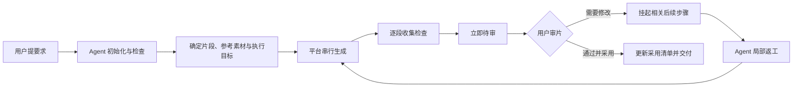
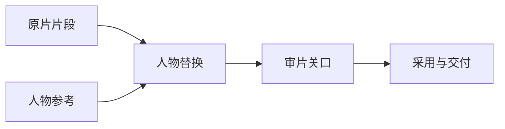

# ComfyPilot 技术调研与分期

日期：2026-10-27（Asia/Shanghai）

范围：官方公开文档与现有项目经验。下文区分来源已说明的能力、本项目的设计选择，以及发布前仍需实测的内容。没有在本次任务中安装工具、运行 ComfyUI 或验证第三方功能。

产品边界见[产品需求](product-requirements.md)，首发要求见[首版范围与验收](mvp-scope.md)，技术契约见[架构设计](architecture.md)。

## 1. 调研结论

推荐先做“Agent 操作、用户实时审片”的项目工作台，把现有视频生产经验产品化。生成与环境管理尽量利用 ComfyUI 已有接口和官方工具，平台重点处理项目状态、版本、审片反馈、可靠执行与素材占用。

后续简化画布使用业务节点封装配方：用户看到“参考人物、人物替换、审片”等步骤，底层仍是可追踪的 ComfyUI 工作流。这样可以同时满足 Agent 编排与用户微调，不需要首版复制完整 ComfyUI 编辑器。

## 2. 官方方案及可借鉴部分

### 2.1 Frame.io：围绕具体版本和画面反馈

Frame.io 支持单帧、时间范围、位置锚点和画面标注；比较视图支持联动播放，并要求评论指向明确的比较对象。参考[批注说明](https://help.frame.io/en/articles/9105251-commenting-on-your-media)与[比较视图](https://help.frame.io/en/articles/9952618-comparison-viewer)。

ComfyPilot 采用以下交互：

- 默认进入待审结果，用户点击反馈就能定位对应时间和截图。
- 评价绑定版本，原片、候选和已采用版本明确标识，不能把批注留到错误对象上。
- “需要修改”与“通过并采用”作为主要操作，参数和执行证据按需展开。
- 默认同步对比，存在时间映射才联动；不把并排播放包装成准确对齐。

本项目增加自己的执行语义：“需要修改”可以挂起关联方案尚未提交的步骤。这是本项目设计，不是对 Frame.io 自动调度能力的引用。

### 2.2 Comfy CLI：复用环境与工作流操作能力

官方 Comfy CLI 文档列出了节点安装、依赖处理、环境快照与恢复等命令；当前产品页也提供面向编码 Agent 的 Skills 和结构化操作入口。参考[节点命令](https://docs.comfy.org/comfy-cli/reference)、[入门说明](https://docs.comfy.org/comfy-cli/getting-started)与[Agent 使用入口](https://comfy.org/cli)。

本项目的取舍：

- Agent 安装节点时优先复用现有工具，平台保存依赖声明、目标环境和验证证据。
- CLI 不是首版服务必需的全局守护进程，也不承担平台项目数据库。
- 生成提交仍经过 ComfyPilot 的持久执行路径；不能让 Agent 同时使用另一条 CLI 提交路径绕过意图、次数和收片记录。
- 明确指定本机/目标环境，不依赖工具的全局默认值。官方文档说明某些命令会根据登录状态选本机或云端，因此不能原样采用其自动路由。
- 只采用锁定版本并实测的命令；实验性图编辑和云端快捷接口不成为首发前置条件。

这些资料说明可复用的能力方向，尚未证明任意远程 HTTP 地址都能通过 CLI 安装依赖。具体远端环境仍需要用户允许的管理通道。

### 2.3 ComfyUI Subgraph：封装复杂度，保留原始图

ComfyUI 的 Subgraph 支持复用、嵌套和向父节点暴露参数；官方说明同时区分局部节点 ID、执行 ID 与定位 ID，并指出 widget promotion 行为仍在演进。参考[官方 Subgraph 文档](https://docs.comfy.org/custom-nodes/js/subgraphs)。

本项目借鉴“封装配方、只暴露必要参数”，不把三种图混成一个 JSON：

| 图 | 保存内容 | 用途 |
| --- | --- | --- |
| 业务图 | 片段、参考人物、生成、审片、交付等高层步骤与类型连接 | Agent 编排与用户理解 |
| ComfyUI 画布图 | 原始节点、widget、布局和子图 | 保留编辑原件、在 ComfyUI 中打开 |
| 执行 API 图 | 实际提交的节点、参数和依赖引用 | 执行、回执关联与故障追溯 |

不自行猜测子图和 widgets 数组的转换。优先使用经过版本验证的官方工具或 ComfyUI 导出能力；转换失败时保留原件并返回缺项。首版所有预设均带可直接校验的执行图。

### 2.4 React Flow：业务画布组件，不是执行引擎

React Flow 支持自定义节点与连接端口，适合在节点里放入素材预览、参数输入和状态。参考[官方自定义节点文档](https://reactflow.dev/learn/customization/custom-nodes)，本次同时查询了官方文档索引中的受控节点状态示例。

建议第二期采用 React Flow 承担拖拽、连线、选择和缩放。图校验、版本、调度、转换和持久化仍由本项目定义。节点的屏幕位置变化只影响布局，参数或连接变化才产生语义修订。

不在首版预先引入多人 CRDT。Agent 与用户通过操作 patch 和 expected_revision 合作，先保证冲突可见、草稿不丢失。

### 2.5 Hugging Face 缓存管理：先给清单，再按引用删除

Hugging Face 缓存文档提供 dry-run 和删除策略，说明共享内容在仍有引用时不能按单一条目直接删除。参考[官方缓存管理说明](https://huggingface.co/docs/huggingface_hub/guides/manage-cache)。

本项目采用“归属清单 + 引用保护 + 准备/执行两阶段 + 删除前复核”。这里只借鉴管理模式，不引入 Hugging Face 运行依赖，也不照搬其缓存目录结构。

清理目标是 ComfyUI 上本项目管理的副本。逻辑版本和物理副本分开，删除远端副本不能让审片页面丢失已采用结果。移动到同盘回收站不会释放相应磁盘占用，界面不能把它算作已回收空间。

### 2.6 MCP 与 ComfyUI 接口：不要推断不存在的能力

MCP stdio 的子进程由客户端启动，因此“安装后待机”应由桥接器行为实现，不应承诺宿主不会启动它。参考[stdio 规范](https://modelcontextprotocol.io/specification/2026-07-28/basic/transports/stdio)。

ComfyUI 官方路由列出图片上传、文件读取、任务与用户数据操作，但不能据此推断通用视频上传、任意素材物理删除或远端软件安装已经可用。参考[标准路由表](https://docs.comfy.org/development/comfyui-server/comms_routes)。

所以第一版把执行、素材传输、受管删除和环境安装分成独立能力。远程完整视频链路配套一个受限素材桥接扩展；Agent 使用另一条管理通道安装节点与扩展。

## 3. 关键产品场景

### 3.1 首版用户路径

浏览器的主区域是可审结果，Agent 的操作说明和执行证据放侧栏。用户不必理解节点安装和 prompt_id 才能审片，但需要时能查看本次输入、参数和来源。

等待中的 Agent 可以有限时长读取事件。平台先落实反馈挂起，再通知 Agent；不能把“审片立即影响生产”建立在宿主恰好在线上。

### 3.2 第二期简化画布

用户看到一条由 Agent 排好的业务流程，例如：

业务节点显示缩略图、几个常用参数、状态和执行端。用户可更换参考素材、调整片段范围/强度、选择配方或重排允许的步骤；高级操作可打开原 ComfyUI 工作流。

编辑规则：

1. Agent 生成草稿，用户拖拽修改同一份业务图；不维护互不相通的两份计划。
2. 拖动位置只保存布局；改参数、输入、执行端或连接形成新语义修订。
3. 草稿保存不触发 GPU 运行；明确执行或已有指示允许的修订生效后再派发。
4. 在途运行固定旧版本，界面说明“当前运行”和“下次生效”的差别。
5. 类型不匹配、缺依赖、循环或未知输出在执行前显示，不让用户面对底层节点报错。
6. 第一个可编辑版本限定少量预设节点和有向无环流程，复杂循环与条件调度再单独评估。

优先让业务节点对应已验证 Recipe；第二期按真实人物替换返工流程验证后，再推广到其他模块。画布可序列化不等于已经具备可靠的图执行引擎。

## 4. 分期路线

| 阶段 | 目标 | 主要范围 | 进入下一阶段的依据 |
| --- | --- | --- | --- |
| 第一期 | 视频生产与实时审片 | 项目服务、待机 MCP、Skill、多执行端、人物替换、资源说明、远程传输、反馈返工、清理与恢复 | P0 全部验收；本机/远程真实项目持续使用 |
| 第二期 | Agent 编排后用户微调 | 受限业务图、配方参数面板、素材替换、修订差异和受影响任务提示 | 用户可自行微调且不会改坏在途任务 |
| 第三期 A | 图片模块 | 文生图、图生图/局部修改；复用任务、版本、对比、反馈和清理 | 至少一套已验证配方形成独立模块 |
| 第三期 B | 视频生成模块 | 文生视频、图生视频；模型/配方专属输入输出与检查 | 每个模块有独立兼容清单和真实验收 |
| 第四期 | 剧本与分镜编排 | 剧本、场景、镜头、人物设定、关键帧、跨镜头素材复用与选择性重生成 | 已有模块稳定，真实剧本项目需要跨任务依赖 |

第三期 A/B 是建议顺序，可按实际需求调整。第一期支持保存自定义资源，但不宣称所有资源已具备对应的完整业务模块。镜头、剧本等专属实体由模块扩展，不把它们做成核心必填字段。

多执行端的自动负载均衡、并行 GPU 利用和动态环境管理另行评估，不与简化画布绑定发布。

## 5. 仍需纳入设计和实测的问题

以下采用明确默认值，不阻塞当前文档定稿；实现不得把“推荐”写成“已支持”。

| 问题 | 默认处理 | 发布前验证 |
| --- | --- | --- |
| 项目目录是网络盘 | 首版要求状态在当前项目的本机磁盘，发现不满足则报告阻塞；不偷偷移到全局目录 | SQLite/锁与目录诊断 |
| 多项目共用同一 ComfyUI | 专属素材命名空间；不清空队列，默认尊重外部占用 | 两个项目共同运行与清理保护 |
| 节点或模型许可证与下载体积 | 记录来源和许可；权重不默认随包分发，缺项交给 Agent 明确处理 | 预设资源逐项审查 |
| 远程只有 HTTP，无终端 | 已安装环境可按实际能力执行；缺失安装/清理能力明确显示 | 能力降级和缺项提示 |
| 原片加结果占用翻倍 | 原片、结果、代理、远端副本分别记账，检查空间后传输 | 大视频、空间不足、清理后本地审片 |
| 播放时间与原片不一致 | 保存裁剪/偏移/变速映射；无映射不用“逐帧同步”表述 | 不同帧率、偏移及代理定位 |
| Agent 离线或宿主不自动续跑 | 平台持久事件并执行 review_hold，下次连接再接续 | Agent 离线期间的反馈和收片 |
| 用户与 Agent 同时改参数 | expected_revision 冲突与草稿保留，不后写覆盖 | 同一对象竞争更新 |
| 无账号 LAN 的操作边界 | 信任网络内审片，无身份级隔离；进程与破坏性管理留在本机控制路径 | LAN 浏览器不可调用管理操作 |
| 工具更新或默认转云 | 锁定兼容版本、显式目标、保存实际图；不采纳全局自动路由 | 升级预检与目标选择测试 |

尚未确定的包分发形式、精确依赖版本、首发配方与模型组合，在实现 M1/M2 时用实测记录补齐。它们不改变用户已经明确的项目级服务、Agent 主导、无账号和本机/远程双支持方向。
